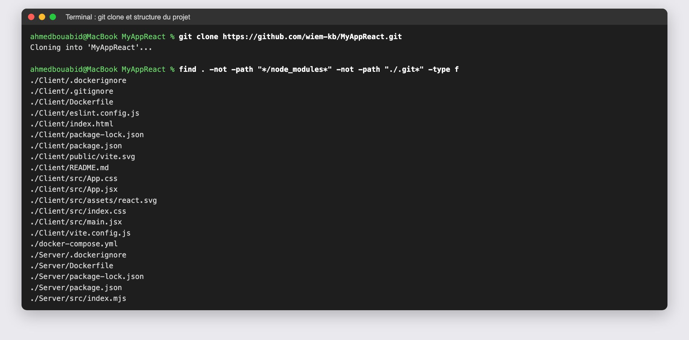
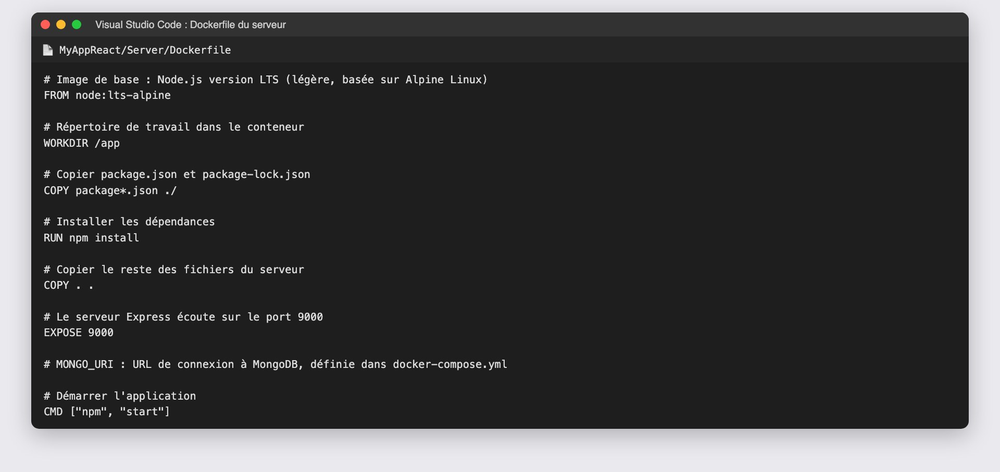
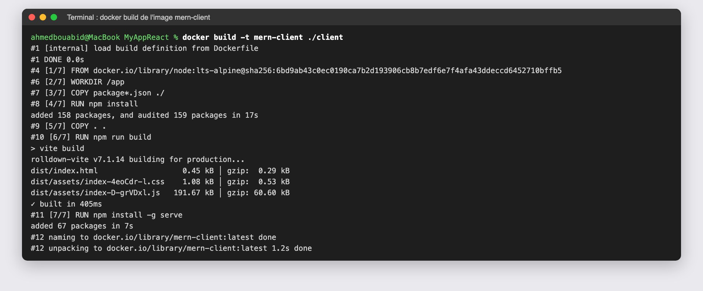
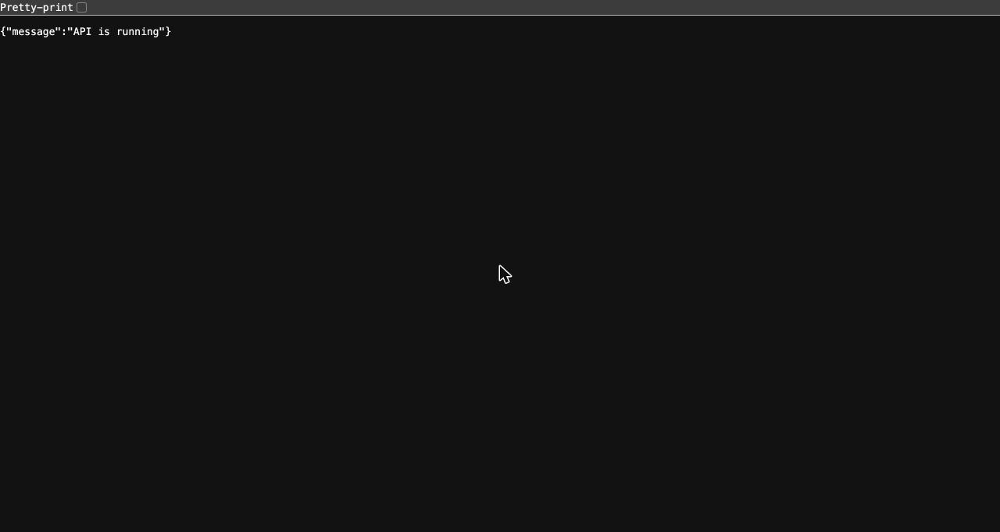

# TP4 : Docker et Docker Compose

**Introduction au DevOps, ISG de Sousse, 3ème année LIG**<br>
**Enseignante :** Zaineb SAKHRAWI<br>
**Réalisé par :** Ahmed Bouabid, 3LIG G2A

Dans ce TP j’ai conteneurisé une application MERN (MongoDB, Express, React, Node.js) avec Docker, d’abord en lançant les conteneurs à la main, puis avec Docker Compose.

Environnement : macOS, Docker Desktop (Docker 29.9.3, Docker Compose v5.7.0).

## Contenu du dossier

| Fichier | Rôle |
|---|---|
| `Server/Dockerfile` | Image du serveur Express (`mern-server`) |
| `Client/Dockerfile` | Image du client React (`mern-client`) |
| `docker-compose.yml` | Lance MongoDB, le serveur et le client ensemble |
| `Server/.dockerignore`, `Client/.dockerignore` | Fichiers à ne pas copier dans les images (node_modules) |
| `captures/` | Captures d’écran de chaque étape |

## 1. Cloner le projet

```bash
git clone https://github.com/wiem-kb/MyAppReact.git
cd MyAppReact
```

Le projet contient deux dossiers : `Client` (application React avec Vite) et `Server` (API Express).



## 2. Créer les Dockerfiles

### a. Serveur (Express)

Le Dockerfile part de `node:lts-alpine`, définit le dossier de travail `/app`, copie `package*.json`, installe les dépendances, copie le reste du code, expose le port 9000 et démarre avec `npm start`. La variable `MONGO_URI` est définie dans `docker-compose.yml`.



```bash
docker build -t mern-server ./server
```


### b. Client (React)

Même début que le serveur, puis `npm run build` construit l’application React dans le dossier `dist`, `serve` est installé comme petit serveur HTTP, le port 3000 est exposé et `serve` sert les fichiers du build.


```bash
docker build -t mern-client ./client
```




## 3. Créer un réseau Docker

```bash
docker network create mern-network
```


## 4. Lancer MongoDB

```bash
docker run -d --name mongodb --network mern-network mongo
```

## 5. Lancer le serveur et le client

```bash
docker run -d --name server --network mern-network -p 9000:9000 mern-server
docker run -d --name client --network mern-network -p 3000:3000 mern-client
```


Vérification : les 3 conteneurs tournent, le serveur affiche « Connecté à MongoDB » et l’API répond.





`/api/db` renvoie `etat_connexion: 1`, ce qui veut dire que le serveur est bien connecté à MongoDB.

Avant de passer à Docker Compose, j’ai arrêté et supprimé ces conteneurs et le réseau (Compose recrée des conteneurs avec les mêmes noms).


## 6. Docker Compose

Le fichier `docker-compose.yml` définit trois services :

* **mongodb** : image `mongo`, conteneur `mongodb`, réseau `mern-network`
* **server** : construit depuis `./Server`, conteneur `server`, port 9000, dépend de `mongodb`, variable `MONGO_URI=mongodb://mongodb:27017/mern`
* **client** : construit depuis `./Client`, conteneur `client`, port 3000, dépend de `server`

Le réseau `mern-network` utilise le driver `bridge`. Dans le réseau, le serveur trouve MongoDB avec le nom du service `mongodb` comme nom d’hôte.


```bash
docker compose up --build
```


Pour arrêter : `docker compose down`.

## Remarques

* Dans le dépôt les dossiers s’appellent `Server` et `Client` avec une majuscule. La commande du TP `docker build -t mern-server ./server` marche sur Mac car le système ne fait pas la différence entre majuscules et minuscules. Dans `docker-compose.yml` j’ai écrit `./Server` et `./Client` pour que ça marche aussi sous Linux.
* L’énoncé donne `docker build -t mern-server ./client` pour le client : j’ai utilisé le nom `mern-client` demandé juste au dessus. De même `docker compose up -- build` s’écrit `docker compose up --build`.
* Le serveur du dépôt ne se connectait pas encore à MongoDB. Comme le conseille l’énoncé, j’ai ajouté la connexion avec `mongoose` et la variable `MONGO_URI` dans `Server/src/index.mjs`, plus une route `/api/db` pour vérifier la connexion.
* Le dossier `node_modules` n’est pas copié dans les images grâce au fichier `.dockerignore` : les dépendances sont installées par `npm install` dans le conteneur.
